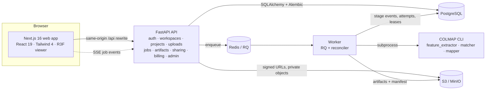

# RoomScape AI

**Turn overlapping property photos into an explorable 3D tour, with real camera poses solved by COLMAP and every limitation stated plainly.**

[](https://github.com/bileldh-ing/Virtual_Visit/actions/workflows/web.yml)
[](https://github.com/bileldh-ing/Virtual_Visit/actions/workflows/api.yml)
[](https://github.com/bileldh-ing/Virtual_Visit/actions/workflows/recon-acceptance.yml)
[](https://github.com/bileldh-ing/Virtual_Visit/actions/workflows/e2e.yml)
[](https://github.com/bileldh-ing/Virtual_Visit/actions/workflows/security.yml)


## What it does

1. **Capture**: upload 20–200 overlapping photos (or 2:1 equirectangular panoramas) per property.
2. **Check**: a capture-quality report measures blur, exposure, duplicates and ORB feature overlap, and tells you how to fix each problem before you spend reconstruction minutes.
3. **Reconstruct**: a worker runs COLMAP structure-from-motion: SIFT features, exhaustive matching, incremental mapping. Progress is streamed live from persisted stage events (SSE, polling fallback).
4. **Explore**: a Three.js viewer loads the real PLY point cloud and camera poses: orbit and first-person walk, camera frustums as hotspots, a filmstrip of the source photos, an auto-tour, and a minimap built from the real top-down render.
5. **Share**: expiring, revocable links with optional password and website embed. EXIF originals and the private address are never shared.

### Honest by design

| Layer | Status on a CPU worker |
|---|---|
| Camera viewpoints | **Reconstructed** (COLMAP) |
| Sparse point cloud | **Reconstructed** (triangulated features) |
| Floor orientation | **Inferred** (mean camera up-vector) |
| Scale / measurements | **Inferred, relative only**, so measurement is disabled in the UI |
| Dense point cloud / mesh | **Unavailable**: COLMAP dense stereo needs CUDA |
| Gaussian splatting | **Unavailable**: GPU-gated, the API refuses the mode |

Real reference run (`docs/RECONSTRUCTION_SPIKE.md`): **48 photos → 42 registered, 3,519 points, 0.598 px mean reprojection error, 300 s on 2 CPUs.**

## Architecture



* **apps/web**: Next.js App Router, TypeScript, Tailwind CSS 4, framer-motion, @react-three/fiber + drei, TanStack Query, zod. Liquid Glass design system (`app/globals.css`).
* **services/api**: FastAPI, SQLAlchemy 2, Alembic, Argon2id, HMAC-signed file URLs, rate limiting, audit log, versioned plans.
* **services/worker**: RQ worker with leases, heartbeats, retries with backoff and a reconciler that recovers lost attempts.
* **services/reconstruction**: `roomscape-recon` library + CLI: capture QA, COLMAP adapter, artifact contract (PLY, `cameras.json`, preview, quality report, checksummed manifest).

## Screens

| | |
|---|---|
|  |  |
|  |  |
|  |  |

## Quick start (Docker)

```bash
cp .env.example .env
docker compose up --build
# web http://localhost:3000 · API http://localhost:8000/docs · MinIO console http://localhost:9001
```
Sign up with the address in `ROOMSCAPE_BOOTSTRAP_ADMIN_EMAIL` to become platform admin. In development, verification and reset emails are readable at `GET /api/v1/dev/outbox?to=<email>`.

Seed a demo project with the licensed sample photos and a real reconstruction:
```bash
python scripts/fetch_fixture.py eyeful_apartment_48
python scripts/seed_demo.py --api http://localhost:8000 --images tests/fixtures/reconstruction/eyeful_apartment_48/images
```

## Local development without Docker

```bash
python -m venv .venv && . .venv/bin/activate
pip install -e services/reconstruction -e "services/api[dev]" -e services/worker
bash scripts/dev_up.sh                     # API :8000 + worker (needs Postgres, Redis, COLMAP)
cd apps/web && pnpm install && pnpm dev    # web :3000
```

## Quality gates

| Workflow | What it runs |
|---|---|
| `web` | ESLint, `tsc --noEmit`, Vitest with coverage, `next build` |
| `api` | Ruff, mypy, pytest unit + integration on PostgreSQL 17 and Redis 7 service containers, coverage |
| `recon-acceptance` | apt-installs COLMAP, downloads the SHA-256-pinned fixture, reconstructs 21 photos, verifies metrics and manifest |
| `e2e` | Starts API, worker and the production web build; Playwright: sign-up, email verification, project, upload, capture check |
| `docker` | Builds api, worker and web images (GHCR on push) + Trivy image report |
| `security` | CodeQL (Python, TypeScript), pip-audit, pnpm audit, gitleaks, Trivy filesystem |
| `lighthouse` | Lighthouse CI on landing and auth pages (accessibility ≥ 0.9 enforced) |
| `deploy` | Staging on `main`, production on `v*` tags; skips with a notice when deploy secrets are absent |

## Documentation
* [Feature matrix](docs/FEATURE_MATRIX.md): truthful status of every feature
* [Reconstruction spike](docs/RECONSTRUCTION_SPIKE.md): real numbers and failure modes
* [Security policy](SECURITY.md) · [Third-party notices](THIRD_PARTY_NOTICES.md)

## Licence
Apache-2.0. Sample photos: Eyeful Tower dataset © Meta Platforms, Inc. and affiliates (MIT).
