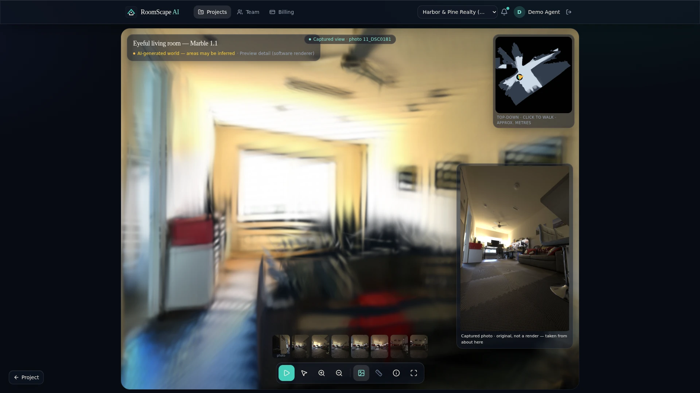
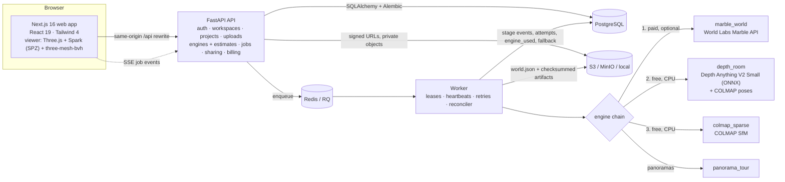
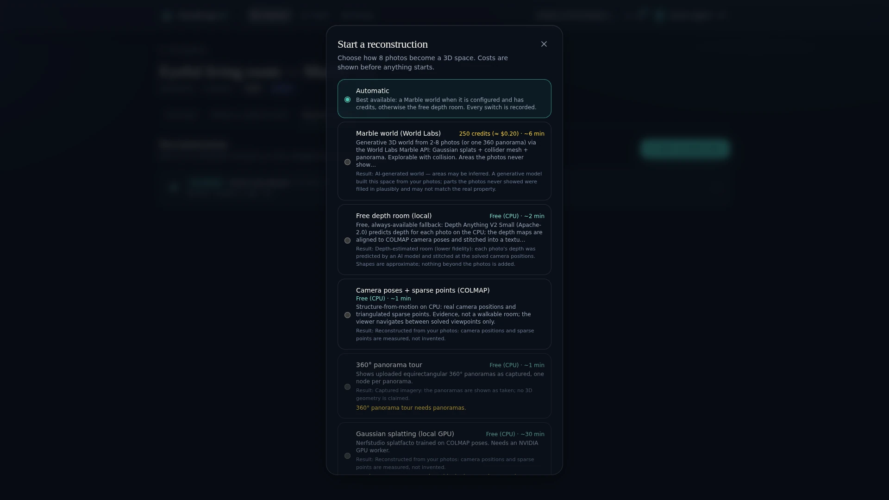
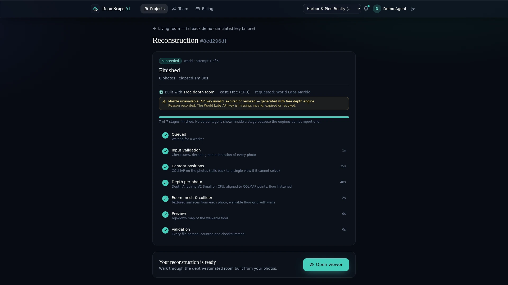
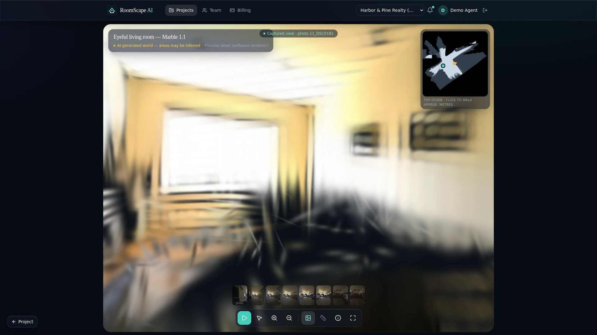
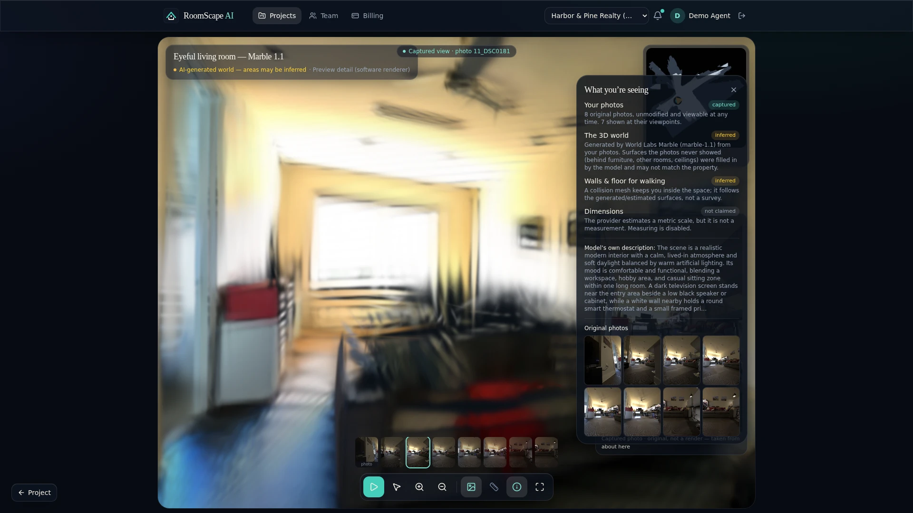
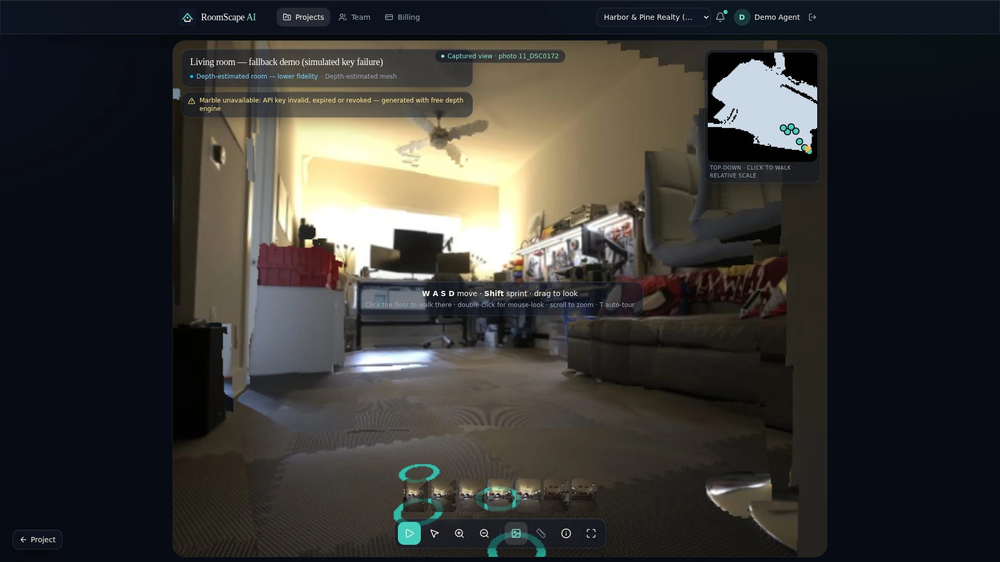

# RoomScape AI 2.0

**Upload a few photos of a room and walk through it in the browser.** RoomScape tries a generative engine first
(World Labs Marble), falls back to free local engines when it cannot use it, and labels every result with how
much of it was actually captured.

[](https://github.com/bileldh-ing/Virtual_Visit/actions/workflows/web.yml)
[](https://github.com/bileldh-ing/Virtual_Visit/actions/workflows/api.yml)
[](https://github.com/bileldh-ing/Virtual_Visit/actions/workflows/e2e.yml)
[](https://github.com/bileldh-ing/Virtual_Visit/actions/workflows/recon-acceptance.yml)
[](https://github.com/bileldh-ing/Virtual_Visit/actions/workflows/security.yml)
[](https://github.com/bileldh-ing/Virtual_Visit/actions/workflows/lighthouse.yml)
[](https://github.com/bileldh-ing/Virtual_Visit/actions/workflows/docker.yml)
[](https://github.com/bileldh-ing/Virtual_Visit/actions/workflows/deploy.yml)



<sub>A `marble-1.1` world generated from 8 Eyeful Tower living-room photos, rendered in headless Chromium with the
software (SwiftShader) renderer and the 100k-splat preview, so it is softer than on a GPU. The inset is the original
photo, placed at its heading.</sub>

## What it does

1. **Capture.** Upload photos (2–8 for a Marble world, more for COLMAP) or 2:1 equirectangular panoramas. Server-side
   checks: magic bytes must match the decoded format, ≤ 20 MB per file, ≤ 100 MP, shortest side ≥ 256 px. A
   capture-quality report flags blur, exposure, duplicates and weak overlap before anything is spent.
2. **Pick an engine.** The picker shows the live Marble credit balance, the estimate for the chosen model, and the
   free alternatives. **Fall back automatically** is on by default.
3. **Reconstruct.** A worker runs the engine chain with leases, heartbeats, retries and checkpoints. Paid Marble
   operations are checkpointed before and after the paid call, so a crashed worker resumes the same operation
   instead of paying twice.
4. **Walk.** The viewer renders Gaussian splats (Spark, SPZ) or a textured depth mesh. WASD/arrow keys and
   drag-to-look, collision against the collider mesh (three-mesh-bvh), a minimap with a click-to-walk position,
   photo hotspots with door-fade transitions, an auto-tour, and the original photos.
5. **Know what is real.** Each view is labelled **Captured view · photo X** when one of your photos looked that way,
   or **Inferred area · no photo looked this way** when it did not. The *What you're seeing* panel (press `i`)
   separates captured, inferred and not-claimed layers. Measuring stays disabled.
6. **Share.** Expiring, revocable links with an optional password and an embed allow-list. EXIF originals and the
   private address are never shared.

## Architecture



## The engine chain

```
photos     : marble_world → depth_room → colmap_sparse
panoramas  : marble_world → panorama_tour
```

| Engine | Result label | Output | Cost |
|---|---|---|---|
| `marble_world` | AI-generated world, areas may be inferred | Gaussian splats (SPZ 100k + 500k), collider GLB, 360° pano, `world.json` | World Labs credits |
| `depth_room` | Depth-estimated room (lower fidelity) | textured depth mesh per photo at COLMAP poses, flattened floor, walk collider | free (CPU) |
| `colmap_sparse` | Reconstructed (camera poses + sparse points) | PLY point cloud, `cameras.json`, top-down preview | free (CPU) |
| `panorama_tour` | Captured | one node per uploaded panorama | free |
| `gaussian_splat_local` | — | splatfacto on COLMAP poses | needs an NVIDIA GPU worker; **always skipped here** |

The chain moves to the next engine only on provider or engine problems:

| Trigger | Category |
|---|---|
| key missing, invalid, expired or revoked (HTTP **401 / 403**) | `PROVIDER_AUTH` |
| out of credits (HTTP **402**) or **balance below the estimate** at preflight | `PROVIDER_CREDITS` |
| HTTP 429 after bounded retries | `PROVIDER_RATE_LIMITED` |
| 5xx / connection errors after retries (**outage**) | `PROVIDER_UNAVAILABLE` |
| operation or asset publication past `ROOMSCAPE_MARBLE_OPERATION_TIMEOUT_S` (**timeout**) | `PROVIDER_TIMEOUT` |
| input refused, or generation failed / returned no world | `PROVIDER_REJECTED` / `PROVIDER_FAILED` |
| engine not configured, no GPU, unusable photos | `ENGINE_UNAVAILABLE`, `GPU_UNAVAILABLE`, `INSUFFICIENT_*` … |

Cancellation, worker OOM, a lost worker and internal errors are **not** fallbacks: they go to the job's retry
policy so a paid operation is resumed rather than repeated. The job records `engine` (requested), `engine_used` and
`fallback {from, to, reason_code, reason}`, and the job page, job list and project overview show them.
Details: [docs/ENGINES.md](docs/ENGINES.md).

## Measured on this project

All numbers below are from real runs on the same 8 Eyeful Tower living-room photos, on a 2-vCPU sandbox without a GPU
([docs/MARBLE_SPIKE.md](docs/MARBLE_SPIKE.md)).

| Run | Engine | Result | Time | Cost |
|---|---|---|---|---|
| `9fc8e78d` | `marble_world`, `marble-1.0-draft` | world, no scale estimate | **101.4 s** in the worker (generation wait 61.9 s) | **250 credits** |
| `0bad6c5a` | `marble_world`, `marble-1.1` | world, provider **metric scale** estimate (factor 1.00067) | final attempt 52 s; 6 min 50 s including two worker OOM kills, resumed **without a second charge** | **1,600 credits** |
| `d88219ac` | requested `marble_world`, key rejected → **`depth_room`** | depth room, 7 of 8 photos posed by COLMAP (before the floor fix) | **42 s** | free |
| `8ed296df` | same fallback, rerun after the floor fix | floor flattened in all 7 views (floor RMS 0.17–0.40 → 0.011–0.028, relative units); walking stopped by the collider | 86 s (CPU shared with other work) | free |

The key failure for the fallback runs is simulated with `ROOMSCAPE_MARBLE_SIMULATE_FAILURE=auth`, a development-only
switch that makes every World Labs call return 401 without touching the real key.

The heading of the photo hotspots in Auto Layout Marble worlds is registered against the generated panorama
(`heading_alignment`, +75° on this world); before that fix the overlays pointed the wrong way.

## Screens

| | |
|---|---|
|  |  |
| **Engine picker**: estimate per engine before anything starts | **Fallback recorded**: requested Marble, built with the free depth room, reason shown |
|  |  |
| **Walking** a Marble world: WASD, collision, minimap | **What you're seeing**: captured vs inferred vs not claimed |
|  |  |
| **Depth room** (fallback): lower fidelity, real camera positions | **Captured view**: the original photo at its heading |

## Demo video

<!-- TODO(next agent): embed the RoomScape AI 2.0 demo video here (link or GIF + duration). Do not reuse 1.0 footage. -->
_Coming soon._

## Limitations (read these)

* **No GPU Gaussian splatting here.** The local `gaussian_splat_local` engine needs an NVIDIA GPU worker; this
  deployment has none, so it is always skipped. Splat worlds come only from Marble.
* **Not survey-grade.** Marble's metric scale is the provider's estimate; depth rooms are in relative units scaled
  to eye height. Measuring is disabled for every engine.
* **Generated content is labelled.** Marble fills in surfaces no photo showed (behind furniture, other rooms,
  ceilings). The viewer marks views no photo covered as *Inferred area*; the depth room adds nothing beyond the
  photos but its shapes are approximate.
* **Software rendering in CI and in the screenshots.** Headless Chromium uses SwiftShader and the 100k-splat preview,
  so frames are softer and slower than on a GPU.
* **Marble needs your own World Labs key and credits** (`WLT_API_KEY`). CI never calls the paid API; adapter tests use
  a mocked transport and recorded fixtures.
* Dense COLMAP stereo / meshing needs CUDA and is not run.

## Quick start (Docker)

```bash
cp .env.example .env          # optional: set WLT_API_KEY= to enable Marble; leave empty for the free engines only
docker compose up --build
# web http://localhost:3000 · API http://localhost:8000/docs · MinIO console http://localhost:9001
```

Sign up with the address in `ROOMSCAPE_BOOTSTRAP_ADMIN_EMAIL` to become platform admin. In development,
verification and reset emails are readable at `GET /api/v1/dev/outbox?to=<email>`. The worker image bakes in COLMAP,
ONNX Runtime 1.31.0 and Depth Anything V2 Small at a pinned Hugging Face revision (SHA-256 checked).

Sample photos (Eyeful Tower, MIT):

```bash
python scripts/fetch_fixture.py eyeful_apartment_48
python scripts/seed_demo.py --api http://localhost:8000 --images tests/fixtures/reconstruction/eyeful_apartment_48/images
```

### Local development without Docker

```bash
python -m venv .venv && . .venv/bin/activate
pip install -e "services/reconstruction[depth]" -e "services/api[dev]" -e services/worker
bash scripts/dev_up.sh                     # API :8000 + worker (needs Postgres, Redis, COLMAP)
cd apps/web && pnpm install && pnpm dev    # web :3000
```

## Tests

```bash
pytest tests/unit tests/integration        # engines, Marble adapter (mocked), depth room, heading alignment, state machine, API flows
cd apps/web && pnpm test                   # Vitest: viewer math, world navigation, trust labels, PLY, quality
cd apps/web && pnpm exec playwright test   # e2e: sign-up/verify/upload flow, smoke, walkable-world viewer on a committed SPZ + GLB fixture
```

| Workflow | What it runs |
|---|---|
| `web` | ESLint, `tsc --noEmit`, Vitest with coverage, `next build` |
| `api` | Ruff, mypy, pytest unit + integration on PostgreSQL 17 and Redis 7 |
| `recon-acceptance` | installs COLMAP, downloads the SHA-256-pinned fixture, reconstructs, verifies metrics and the manifest |
| `e2e` | API + worker + production web build; Playwright flows and the walkable-world viewer (loads, walks, stops at the wall, renders) |
| `docker` | builds api, worker and web images + Trivy report |
| `security` | CodeQL, pip-audit, pnpm audit, gitleaks, Trivy filesystem |
| `lighthouse` | Lighthouse CI on landing and auth pages (accessibility ≥ 0.9) |
| `deploy` | staging on `main`, production on `v*` tags; skips with a notice when deploy secrets are absent |

## Documentation

* [Engines and fallback rules](docs/ENGINES.md)
* [Marble spike: real runs, costs, failure recovery](docs/MARBLE_SPIKE.md)
* [Feature matrix](docs/FEATURE_MATRIX.md): truthful status of every feature
* [COLMAP reconstruction spike](docs/RECONSTRUCTION_SPIKE.md)
* [Security policy](SECURITY.md) · [Third-party notices](THIRD_PARTY_NOTICES.md)

## Licence

Apache-2.0. Sample photos: Eyeful Tower dataset © Meta Platforms, Inc. and affiliates (MIT). Depth model: Depth
Anything V2 Small (Apache-2.0). World Labs Marble is a third-party paid service used only with your own key.
